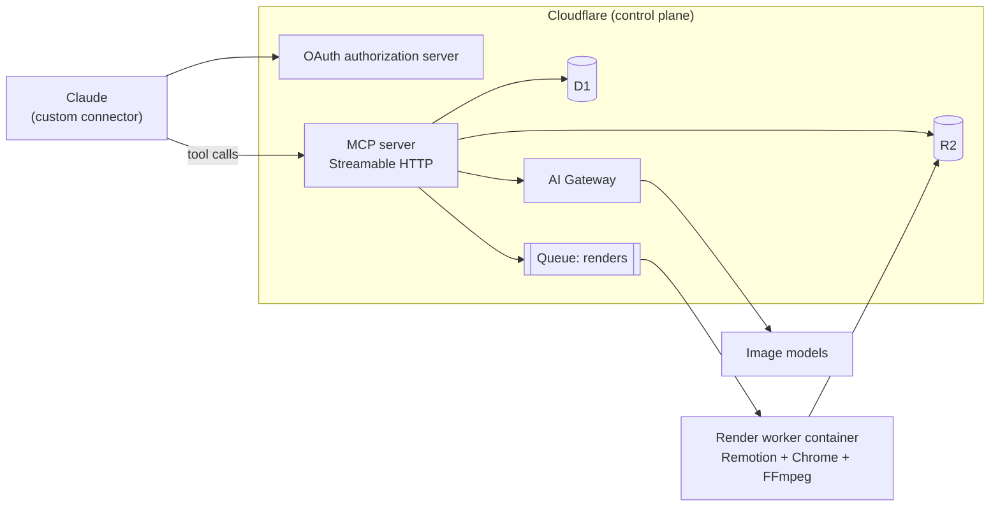

# ai-content-platform

A learning project: an AI content creation tool that runs inside Claude.
Claude connects to a remote MCP server as a custom connector. Invited users sign in with a `creator` or `admin` role.
The server gives Claude versioned workflow instructions and stable tools for real-estate listings. It logs every tool call per user.
Image generation goes through an AI gateway with per-user limits and cost tracking. Video renders (Remotion) run on a separate worker behind a queue.
This repo has the plan, the architecture and a runnable TypeScript skeleton that needs no cloud account.



## Docs

- [Architecture](docs/architecture.md): goals, components, flows, data model, tool contract, failure modes, security, cost.
- [Architecture decision records](docs/adr/README.md): cloud, MCP transport and auth, database, render hosting, queue.
- [Learning plan](docs/learning-plan.md): milestones M0 to M7 that you build and check yourself.

## Quick start

Needs Node.js 24.2 or later. Node runs the `.ts` files directly; there is no build step.

```bash
npm ci
npm test                    # 9 tests
npm run start:server        # MCP server on http://127.0.0.1:3000/mcp
npm run start:worker        # second terminal: render worker
```

Call tools from a third terminal. The local seed has two dev tokens: `dev-creator-token` (default) and `dev-admin-token`.

```bash
npm run call -- list_listings '{"limit":1}'
npm run call -- start_render '{"listing_id":"listing_1","template":"listing_tour","idempotency_key":"demo-render-001"}'
npm run call -- get_render '{"render_id":"<render_id>"}'
MCP_TOKEN=dev-admin-token npm run call -- list_tool_calls '{"limit":5}'
```

`get_render` returns a signed `video_url`. The fake renderer writes a small text file in place of an MP4.

Connect Claude Code to the local server:

```bash
claude mcp add --transport http content-platform http://127.0.0.1:3000/mcp \
  --header "Authorization: Bearer dev-creator-token"
```

Local data lives in `.data/` (SQLite database and object files). Delete it to reset. Set `DATA_DIR` to use another folder.

## Layout

| Path | Contents |
|---|---|
| `src/server.ts` | HTTP entry: bearer auth, `/mcp`, signed file URLs |
| `src/mcp-server.ts` | Tools, and the wrapper that checks roles and logs each call |
| `src/auth.ts` | Token verifier and roles |
| `src/renders.ts`, `src/listings.ts`, `src/tool-calls.ts` | Domain services |
| `src/render-queue.ts`, `src/render-worker.ts` | Local queue and render worker |
| `src/object-store.ts` | Local object storage with signed URLs |
| `src/schema.sql`, `src/database.ts` | SQLite schema (D1-compatible) and seed data |
| `scripts/call-tool.ts` | MCP client that calls one tool |
| `test/` | Tests for role checks, logging, idempotency, retries, signed URLs |
