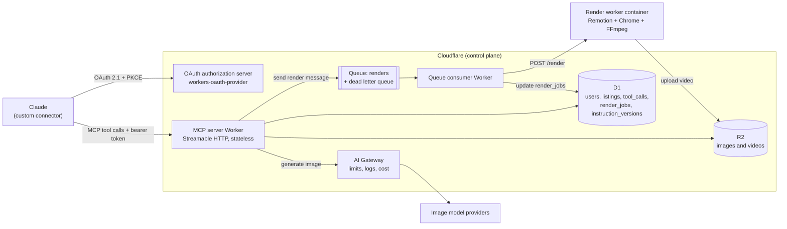
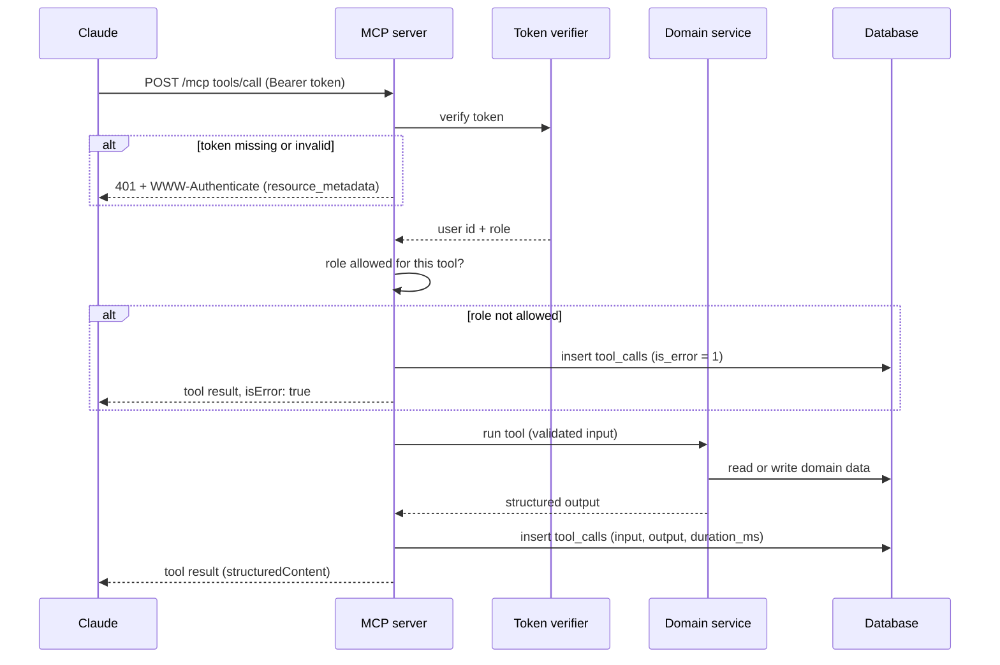
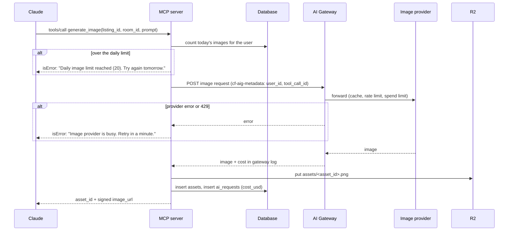
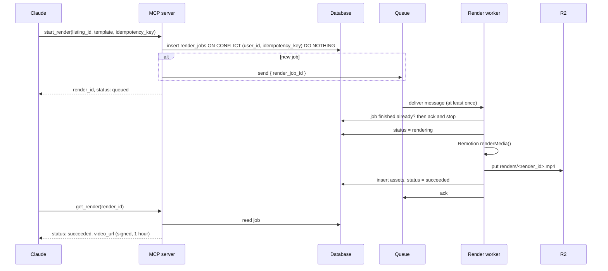
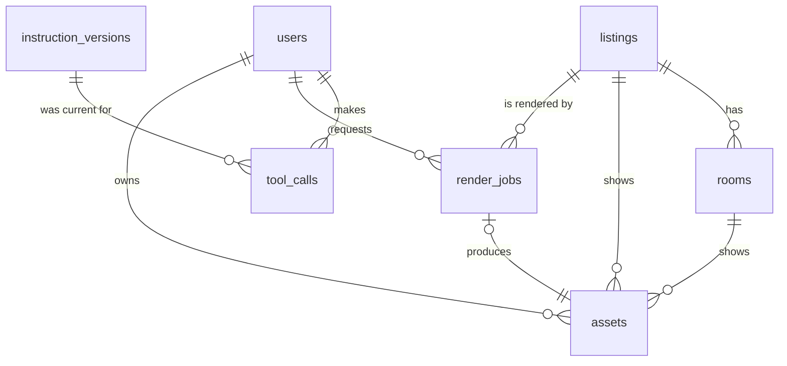

# Architecture

This document describes a pilot of an AI content creation tool that runs inside Claude.
It is a learning design. It uses the simplest parts that still scale.
The [ADRs](adr/README.md) record each real choice. The [learning plan](learning-plan.md) builds it step by step.

Facts in this document were checked against the official docs on 2026-11-18. Links are inline.

## 1. Problem

Creators make marketing content for real-estate listings: images of rooms and short videos of a property.
They want to ask Claude for the content in plain words. Claude must use the right data, the right tools and the right workflow.
The team must see every step, control cost per user, and turn good runs into reusable templates.

## 2. Goals and non-goals

Goals:

- Claude connects to one **remote MCP server** as a [custom connector](https://support.claude.com/en/articles/11175166-get-started-with-custom-connectors-using-remote-mcp).
- Only invited users can sign in. Each user has one role: `creator` or `admin`.
- The server gives Claude **versioned workflow instructions**.
- Tool names, IDs and schemas stay **stable**. Changes add new tools; they never rename old ones.
- The server **logs every tool call** per user, with input and output.
- Image generation goes through an **AI gateway** with per-user limits and cost tracking.
- Video renders run on a **separate render worker** behind a **queue**. Remotion needs Chrome and FFmpeg, so it cannot run in a Worker.

Non-goals for the pilot:

- A custom web UI. Claude is the UI.
- Multi-tenant billing, payments, or self-service sign-up.
- Real-time collaboration or video editing.
- Multi-region data residency.

## 3. Components

| Component | Job | Local stand-in in this repo |
|---|---|---|
| MCP server | Serves tools over [Streamable HTTP](https://modelcontextprotocol.io/specification/2026-07-28/basic/transports). Checks the role and logs every call. | `src/server.ts`, `src/mcp-server.ts` |
| Authorization server | Signs users in (invite-only) and issues OAuth access tokens. | `access_tokens` table with dev tokens (`src/auth.ts`) |
| Database (D1) | Users, domain data, logs, jobs, instruction versions. | SQLite file through `node:sqlite` (`src/database.ts`) |
| Object storage (R2) | Images and videos. Clients get signed URLs. | Files under `.data/objects` and HMAC-signed URLs (`src/object-store.ts`) |
| Queue | Carries render requests to the render worker. At-least-once delivery. | `queue_messages` table (`src/render-queue.ts`) |
| Render worker | Runs Remotion `renderMedia()` in a container. | `src/render-worker.ts` with a fake renderer |
| AI gateway | Proxies image model calls. Adds rate limits, spend limits, logs and cost. | Not in the skeleton. Milestone M4. |

## 4. Main flows

### 4.1 Tool call: auth, role check, domain service, log

The role check and the log row live in **one wrapper** around every tool (`buildMcpServer` in `src/mcp-server.ts`).
A tool cannot skip them.

### 4.2 Image generation through the AI gateway (milestone M4)

- **Our database enforces the hard limit.** It is exact and per user.
- **AI Gateway [spend limits](https://developers.cloudflare.com/ai-gateway/features/spend-limits/) are a backstop.** They can scope by a metadata key such as `user_id`. They are eventually consistent, and costs are estimates.
- [Custom metadata](https://developers.cloudflare.com/ai-gateway/observability/custom-metadata/) (`cf-aig-metadata`, up to 5 entries) ties each gateway log to a user and a tool call.
- [Dynamic routes](https://developers.cloudflare.com/ai-gateway/features/routing/dynamic-routing/) can fall back to a second provider.

### 4.3 Video render: queue, worker, storage, status

Claude polls `get_render`. A tool call has a time limit in Claude ([about 240 s on claude.ai](https://claude.com/docs/connectors/building)), and a render can take longer, so `start_render` returns at once.

## 5. Data model

All tables use SQLite types, so the same schema runs locally and on D1. The skeleton schema is in [`src/schema.sql`](../src/schema.sql).

| Table | Key fields | Notes |
|---|---|---|
| `users` | `id`, `email` (unique), `name`, `role` (`creator`/`admin`), `status` (`invited`/`active`/`disabled`), `daily_image_limit` (M4) | An admin creates the row. That is the invite. |
| `listings` | `id`, `title`, `address`, `price_usd` | Example domain data. |
| `rooms` | `id`, `listing_id`, `name`, `area_m2` | |
| `assets` | `id`, `owner_id`, `listing_id`, `room_id`, `kind` (`image`/`video`), `source` (`upload`/`generated`/`render`), `object_key` (unique), `mime_type`, `size_bytes` | The bytes live in R2. The row is the index. |
| `tool_calls` | `id`, `user_id`, `tool`, `instructions_version`, `input_json`, `output_json`, `is_error`, `error`, `duration_ms`, `created_at` | One row per call. The source for templates. |
| `render_jobs` | `id`, `user_id`, `listing_id`, `template`, `idempotency_key`, `status` (`queued`/`rendering`/`succeeded`/`failed`), `attempt_count`, `output_asset_id`, `error` | `UNIQUE (user_id, idempotency_key)` stops duplicates. |
| `instruction_versions` | `version`, `body`, `is_current`, `created_at` | Append only. Exactly one row is current. |
| `ai_requests` (M4) | `id`, `user_id`, `tool_call_id`, `provider`, `model`, `status`, `cost_usd`, `created_at` | Cost per user comes from this table. |
| `templates` (M6) | `id`, `name`, `source_tool_call_ids`, `instructions_version`, `steps_json` | A saved good run. |

Names follow one rule: plural nouns for tables, one word per concept. Two names differ from the first brief:

| Brief name | Name here | Why |
|---|---|---|
| `tool_call_log` | `tool_calls` | Each row is a tool call; "log" repeats what a table is. |
| `render_job` | `render_jobs` | Plural table names, like the others. |
| `instruction_version` | `instruction_versions` | Same. |

## 6. MCP tool contract

| Tool | Roles | Input | Output | Since |
|---|---|---|---|---|
| `list_listings` | creator, admin | `limit` (1–50, default 20) | `listings[]` with `rooms[]` | M1 |
| `start_render` | creator, admin | `listing_id`, `template` (`listing_tour`), `idempotency_key` (8–100 chars) | `render_id`, `status`, `attempt_count`, `video_url`, `error`, `is_new` | M5 |
| `get_render` | creator, admin (owner or admin) | `render_id` | `render_id`, `status`, `attempt_count`, `video_url`, `error` | M5 |
| `list_tool_calls` | admin | `user_id?`, `limit` (1–100) | `tool_calls[]` | M3 |
| `generate_image` | creator, admin | `listing_id`, `room_id?`, `prompt`, `size` | `asset_id`, `image_url` | M4 |

The skeleton has the first four. Each tool declares an `inputSchema` and an `outputSchema` and returns `structuredContent` ([MCP tools spec](https://modelcontextprotocol.io/specification/2026-07-28/server/tools)).

Versioning rules:

1. A tool name is a public ID. **Never rename a tool and never change a field's meaning in place.**
2. You may add an **optional** input field or a new output field. Old callers still work.
3. Any other change is a new tool: `start_render_v2`. Keep the old tool and mark it deprecated in its description. Remove it only when `tool_calls` shows no use for 30 days.
4. Instructions have their own version (`instruction_versions.version`, for example `2026-11-18.1`). Every `tool_calls` row stores the version that was current, so you can compare runs across versions.
5. Names use `snake_case` and the MCP-allowed characters (`A-Z a-z 0-9 _ - .`, 1–128 chars).

## 7. Failure modes

| Failure | What happens | Design answer |
|---|---|---|
| Claude retries `start_render` | Same `idempotency_key` | The unique key returns the existing job. No second render. |
| The queue delivers a message twice | [At-least-once delivery](https://developers.cloudflare.com/queues/reference/delivery-guarantees/) | The worker skips finished jobs. The output key is `renders/<render_id>.mp4`, so a retry overwrites, not duplicates. |
| The render crashes (Chrome, FFmpeg, out of memory) | The worker throws | Retry with exponential backoff, 3 attempts ([Queues default `max_retries` is 3](https://developers.cloudflare.com/queues/configuration/batching-retries/)). Then `status = failed` and the message goes to the [dead letter queue](https://developers.cloudflare.com/queues/configuration/dead-letter-queues/). |
| The worker dies mid-render | No ack | The message becomes visible again after the visibility timeout and runs again. |
| Job row saved, but the queue send fails | Job stays `queued` | A cron Worker re-sends jobs that stay `queued` for more than 10 minutes. The worker is idempotent, so a double send is safe. |
| Image provider fails or rate-limits | Error or 429 from the gateway | Return a clear tool error. Claude can retry. A gateway fallback route can switch provider. |
| User is over the image limit | Database check fails | Return a tool error with the limit and the reset time. Do not call the provider. |
| Token expired | 401 from `/mcp` | Claude [refreshes the token](https://claude.com/docs/connectors/building/authentication#token-refresh) and retries. |
| Bad input from Claude | Schema check fails | The SDK returns `isError: true` with the reason before the tool runs. |

## 8. Security

- **OAuth for the connector.** The MCP server is an OAuth resource server ([MCP authorization](https://modelcontextprotocol.io/specification/2025-11-25/basic/authorization)). It answers a call with no valid token with `401` and a `WWW-Authenticate` header that points to its protected resource metadata. Claude needs PKCE S256, DCR or a Client ID Metadata Document, and the redirect URI `https://claude.ai/api/mcp/auth_callback` ([Claude connector auth](https://claude.com/docs/connectors/building/authentication)).
- **Invite-only.** The authorization server signs a person in, then accepts them only if `users.status` is `invited` or `active`. Sign-in turns `invited` into `active`.
- **Role check on every call.** One wrapper checks the role before any tool code runs. Object-level checks run in the domain service (for example, `get_render` returns a job only to its owner or an admin).
- **Signed URLs.** Buckets stay private. Tools return [presigned URLs](https://developers.cloudflare.com/r2/api/s3/presigned-urls/) that expire after 1 hour.
- **No tokens in URLs or logs.** Store only a hash of any token. `tool_calls` stores tool input and output, never headers.
- **Host and Origin checks.** The SDK's `createMcpExpressApp` blocks DNS rebinding on localhost ([SDK docs](https://ts.sdk.modelcontextprotocol.io/v2/serving/express)).
- **Secrets** live in Worker secrets or the cloud secret store, never in the repo.

## 9. Observability

- **Per-call log:** `tool_calls` has user, tool, instructions version, input, output, error and duration. Admins read it with `list_tool_calls`.
- **Cost per user:** sum `ai_requests.cost_usd` by user and day. Cross-check with AI Gateway [cost analytics](https://developers.cloudflare.com/ai-gateway/observability/costs/).
- **Render health:** count `render_jobs` by status; alert when the dead letter queue is not empty.
- **Platform logs:** Workers Logs for the Workers; container stdout for the render worker.

## 10. Cost notes

Prices change. Check the linked pages before you decide.

| Item | Driver | Note |
|---|---|---|
| Workers, D1, Queues | Requests | Small at pilot scale. [Queues](https://developers.cloudflare.com/queues/platform/pricing/): about 3 operations per message, 1M operations a month included on Workers Paid. |
| R2 | Stored GB | [No egress fee](https://developers.cloudflare.com/r2/pricing/). Good for video downloads. |
| Render container | Render minutes | [Billed per 10 ms of run time](https://developers.cloudflare.com/containers/platform/pricing/). Stop the container when idle. |
| Image models | Images | The largest variable cost. The per-user daily limit caps it. |
| Remotion license | Team size | [Free for up to 3 people](https://www.remotion.dev/docs/license); a larger company needs a company license. |
